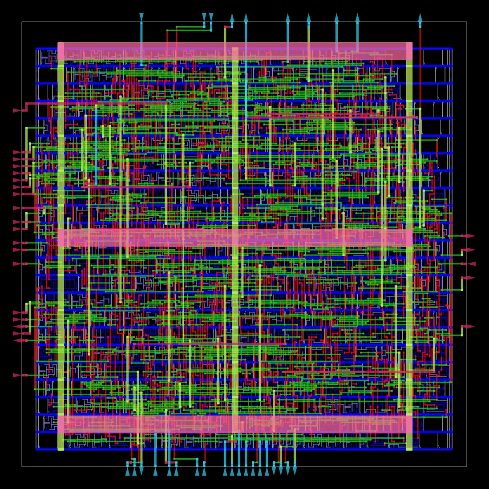

# EDA Copilot

[](https://github.com/LUOaini1213/eda-copilot/actions/workflows/ci.yml)

**What it is** — offline question answering over the scripts and module docs of
OpenROAD / ORFS plus the reports and metrics of one RTL→GDSII run I executed
(nangate45/gcd, 986 instances, 284 s of wall-clock across 19 stage logs). Answers are
retrieved passages cited to file and line; no model, no key.
**What it found** — when a question lacks the premise that decides the answer (setup
or hold? which run?), it stops with one of 7 reason codes: 12/12 stop cases stopped
with the right code, Hit@5 22/23 on 23 retrieval cases; with the guard off, all 12
are answered *with citations*, which is why the guard exists.
**Limits** — one small run with default parameters; all 35 cases are author-written
and the guard was tuned on them. On 20 probes written after the last guard change it
gets 14/20, and 3 of the 6 misses cite the wrong passage (§6).

在开源数字后端流程（OpenROAD / ORFS）的**真实脚本与文档**上做的问答系统。
一句话进来，只回答语料支撑得住的问题；**口径不清、超出语料、或需要本库根本没有的运行结果时，停下来问人，不猜**。

语料里包含**本人跑通的一次真实 RTL→GDSII 运行**的报告、日志与逐阶段结构化指标。
离线运行，**零 token、零费用**，全程不接大模型。

需要 Python 3.11（CI 在 ubuntu 与 windows 上都用 3.11）。Windows / PowerShell（后续命令均在激活后的虚拟环境内执行）：

```powershell
python -m venv .venv
.\.venv\Scripts\python.exe -m pip install -r requirements.txt
.\.venv\Scripts\Activate.ps1
python -m eda_copilot.cli "cts 的 sink clustering 是干什么的"
python eval/run_eval.py      # 检索评测 + 停问评测，写回 eval/results.json
python eval/ablation.py      # 关掉护栏的对照实验，写回 eval/ablation.json
python eval/run_eval.py --check   # 只比对：新跑对不上已提交的产物就退出码 1（CI）
python eval/ablation.py --check   # 同上（CI）
python eval/heldout.py --check    # 20 条留出探针，与 eval/heldout.json 比对（CI）
python -m unittest discover -s tests -v   # 护栏逐条断言 + 产物与 README 数字回算（CI）
```

macOS / Linux：创建环境后运行 `source .venv/bin/activate`，再运行
`python -m pip install -r requirements.txt` 和上面的问答、评测命令。
如果 PowerShell 的执行策略不允许激活，可以把上面每条 `python` 换成
`.\.venv\Scripts\python.exe`，无需修改系统执行策略。

一个带出处的回答，和两次停问：

```text
$ python -m eda_copilot.cli "gcd 的 setup tns 是多少"
依据 run_nangate45_gcd/6_finish.rpt :: 2-10（run，阶段 report）：
...
tns max -7.18
...

$ python -m eda_copilot.cli "ibex 的 cts 是怎么做的"
[停下来问人 · 运行不在库内] 本库只收录了 **nangate45/gcd base** 这一次真实运行（跑到 6_final.gds）。要问这次运行的数值，请在问题里写明 gcd（或 nangate45/gcd）；别的设计本库没有数据。

$ python -m eda_copilot.cli "时序好不好"
[停下来问人 · 双口径歧义] 时序至少有 WNS / TNS / worst slack 三套；面积至少有 die area / core area / utilization 三套。请指定。
```



*语料所依据的那次运行：`openroad/orfs` 官方镜像，nangate45/gcd，986 个实例，19 个阶段日志累计 284 s。更多版面图（拥塞、IR drop、最差路径）在 `run_artifacts/`。*

---

## 1. 为什么做这个

EDA 流程问答有一个特别的失败模式：**问题看起来有答案，其实缺了决定答案的那个前提。**

- 「slack 为什么是负的」——**setup 还是 hold？两者的修复手段方向相反**，
  插 buffer 修 hold 会让 setup 更差。猜错一个，给出的建议正好反向。
- 「时序好不好」——WNS（最差一条）还是 TNS（违例总量）？
  WNS 差 TNS 小是单条路径问题，WNS 一般 TNS 大是全局问题，两种结论要做的事完全不同。
- 「我的设计 WNS 是多少」——**本库只有 nangate45/gcd base 这一次 P&R**，无法回答其他设计或运行的数值。

一个不停问的系统会把这些都答出来，而且**答得带出处**——这比裸奔的模型更危险，
因为出处让人相信它。本项目把「什么时候不该答」做成了系统的一等公民，并**量化了这么做的价值**。

## 2. 语料（全部真实，可复查）

> 语料是第三方开源材料 + 本人运行产物，**非本项目原创**，来源与许可见 [`NOTICE.md`](NOTICE.md)。自有代码为 MIT。

| 目录 | 内容 | 数量 |
|---|---|---|
| `corpus/orfs_scripts/` | OpenROAD-flow-scripts 的流程驱动脚本（TCL 源码） | 16 个文件 |
| `corpus/openroad_docs/` | OpenROAD 各模块 README（ifp/gpl/dpl/cts/grt/drt/rsz/ppl/mpl/stt/pdn/tap/gui/odb/par） | 15 个文件 |
| `corpus/run_nangate45_gcd/` | **本人跑通的一次真实运行**的报告 / 日志 / 逐阶段 metric JSON | 46 个文件 |

**那次运行是真的：**用官方镜像 `openroad/orfs` 在 WSL2 里跑 `nangate45/gcd`，
约 5 分钟走完 yosys 综合 → floorplan → tapcell/PDN → place → CTS → 全局/详细布线 → fill →
`6_final.gds`。复现见 `scripts/run_orfs_flow.sh`，版面图在 `run_artifacts/`。
下面的数字绑定在那次运行的工具版本上：日志里记的是 `OpenROAD 26Q3-1836-g39a75ec608`。
脚本默认拉 `openroad/orfs:latest`，换了版本，TNS、实例数和耗时都可能变；
要对上这里的数，需要用 `IMAGE=` 指定对应那个版本的镜像（本仓没有记下当时的镜像 digest）。
关键结果：**TNS(setup) = −7.18，WNS(setup) = −0.16**，实例数 986，利用率 0.880。

**从自己产出的报告里读出的三条结论**（文件与行号可直接核对）：

1. **违例是全局的，不是单条路径的。**`6_report.json` 第 30 行 `finish__timing__setup__tns = −7.18`，`6_finish.rpt` 里 WNS(setup) = −0.16，比值约 45；同一份文件第 44 行直接记了 `finish__timing__drv__setup_violation_count = 51`——违例摊在几十个端点上，只修最差那条没用。
2. **为修时序插的 buffer 已占标准单元面积 18.7%，时序仍未收敛。**`6_report.json` 第 16–17 行：`timing_repair_buffer` 184 个、176.89 µm²；第 55 行标准单元实例面积 947.758 µm²，176.89 / 947.758 = 18.7%。
3. **报告正文和结构化指标对同一个量给出不同精度。**`6_finish.rpt` 第 31 行印的是 `0.00 setup skew`，`6_report.json` 第 36 行 `finish__clock__skew__setup = 0.000896484`。看报告正文会以为 skew 为零，看指标才知道是 0.9 ps 量级。

切块后 **1215 块**，平均 785 字符（`eda_copilot.ingest` 统计；加入运行产物前是 438）。
`.md` 按标题切并保留标题链，`.tcl` 按语义段切并**保留起止行号**——所以出处能精确到
`orfs_scripts/cts.tcl :: 18-27`。

## 3. 停问机制：7 类结构化原因码

不用自由文本写「我不确定」，而是给结构化 `hitl_code`，让停问本身可统计、可评测。

| 原因码 | 中文 | 触发场景 |
|---|---|---|
| `OUT_OF_SCOPE` | 库外主题 | 问 DRAM 阵列 / 工艺 / 晶圆图——本库只有数字后端 |
| `RUN_OUT_OF_SCOPE` | 运行不在库内 | 本库**只有 nangate45/gcd base 这一次**运行；问别的设计的数值要停 |
| `AMBIGUOUS_METRIC` | 双口径歧义 | 「时序好不好」「面积多大」 |
| `MISSING_CORNER` | 缺时序检查类型 | 时序问题没说 setup / hold |
| `MISSING_STAGE` | 缺阶段 | 问参数/报告但没说哪一步 |
| `UNDEFINED_TERM` | 无口径措辞 | 「优化一下」「帮我看看」 |
| `RELATIVE_RUN` | 相对指代 | 「上次那个 run」 |

**一个关键设计：文档类问题不走面向结果的护栏。**
「`repair_timing` 有哪些 sequence 取值」问的是文档，不是我这次跑出来的数，
不该因为句子里有 "timing" 就被要求先说 setup/hold。这条是**评测逼出来的**（见 §5）。

## 4. 评测结果

### 4.1 检索（23 题，人工标注期望出处）

| 检索器 | Hit@5 | Hit Rate | MRR |
|---|---|---|---|
| **bm25（默认）** | **22/23** | **0.9565** | **0.7841** |
| hybrid | 22/23 | 0.9565 | 0.7746 |
| tfidf | 21/23 | 0.9130 | 0.7514 |

**默认检索器是 bm25。**hybrid 在 Hit@5 上打平（都是 22/23），MRR 更低
（0.7746 对 0.7841），拿不出增益；按 [`docs/PRD.md`](docs/PRD.md) 验收标准第 5 条
（额外组件必须在评测上拿出增益，否则不进默认路径），融合不进默认路径。
三档检索器仍可用 `--mode` 切换，评测每次三档都跑。
默认值改过两次、跨平台 MRR 差异、意图路由和语料去噪的来龙去脉在 [`docs/HISTORY.md`](docs/HISTORY.md)。

默认 bm25 未命中的 1 题：`#16 odb 数据库怎么读写`，三种检索器都没把 `odb_README.md` 排进 top-5，
被 `flow.tcl` 里大量出现的 `odb` 字样淹掉。**如实记录，未做针对性修补。**

### 4.2 停问（12 题）

| | 结果 |
|---|---|
| 该停的停住 | **12/12** |
| 原因码判对 | **12/12** |

**其中一条是评测反过来纠正了我。**我原本写了个用例
「`gcd` 这次 run 的 tns 是多少」并期望它能答，结果被 `MISSING_CORNER` 拦下。
查了自己跑出来的报告才发现**护栏是对的**——`report_metrics.tcl` 里
setup 和 hold 各报一套 TNS，不指明问哪个本来就该停。
于是我把用例改成「setup tns」，另外**新增一条期望它停的用例**。

### 4.3 消融对照：关掉护栏会怎样

同一批题跑两次，A 护栏开 / B 护栏关（`--force`）：

| | A 护栏开 | B 护栏关 |
|---|---|---|
| 该停的停住 | 12/12 | **0/12** |
| 强行作答 | — | **12/12** |
| 靠默认值猜测 | 0 | **12/12** |
| 对 23 题正常问答的回归 | — | **0** |

`--force` 模式会把每次猜测打印出来（「消融模式下做过的猜测」），所以这些猜测
对用户不是静默的；「靠默认值猜测」只是说这 12 条都靠一个默认值才答得出来。

**危害分级（按原因码预先指定，不是逐条判定）：**

| 危害 | 数量 | 含义 |
|---|---|---|
| `TOPIC_DRIFT` | 4 | 问的主题不在库里，答的是别的东西（`OUT_OF_SCOPE` 2 + `UNDEFINED_TERM` 2） |
| `METRIC_GUESSED` | 4 | 猜了一套指标（`AMBIGUOUS_METRIC` 2）或猜了 setup/hold（`MISSING_CORNER` 2——修复手段相反） |
| `WRONG_TARGET` | 2 | 指代/阶段错了（`RELATIVE_RUN` 1 + `MISSING_STAGE` 1） |
| `FABRICATED_FACT` | 2 | 拿本库唯一那次 run 的数值当成你问的那次（`RUN_OUT_OF_SCOPE` 2） |

这张表是 `eval/ablation.py` 里 `HARM` 字典把每条题的原因码换成一个危害标签，
所以 4 / 4 / 2 / 2 就是 12 条题的原因码分布，并没有逐条检查强行作答是不是真的答错。
有的强行作答其实可能答对了：`#35`「gcd 这次 run 的 tns 是多少」默认按 setup 答，引用的
`run_nangate45_gcd/6_finish.rpt :: 2-10` 正好就是 gcd 的 setup TNS。
数字直接来自 `eval/ablation.json`（`python eval/ablation.py --check` 会把一次新跑与它比对，CI 每次都跑）。此前这张表写的是 4 / 3 / 2 / 1：`ablation.py` 里 `RUN_OUT_OF_SCOPE` 的映射键写错，两条本该记为 `FABRICATED_FACT` 的题落成了 `UNKNOWN`，2026-09-03 修正。

**最值得看的一条：**关掉护栏后，「DRAM 的字线和位线怎么布」「晶圆图的缺陷模式怎么分类」
「帮我看看」「优化一下这个流程」**四题的 top-1 出处是同一段**——
`run_nangate45_gcd/6_report.log :: 61-71`，也就是本次运行的面积汇总
（那一段的正文是 `Design area 948 um^2 88% utilization`）。问 DRAM 阵列，答的是这颗
gcd 的面积，还带着行号。
而「我的设计 WNS 是多少」返回 `run_nangate45_gcd/6_finish.rpt :: 2-10`，
那一段的正文就是 `tns max -7.18` / `wns max -0.16`——**看起来完全正确，实际上完全错误**，
因为那是本库唯一那次 nangate45/gcd base 的数，不是提问者那次设计的数。
这十二条的出处逐条记在 `eval/ablation.json` 的 `top_cite` 字段里。

> **带出处的错答比裸奔的错答更危险。**出处让人停止怀疑。
> 这是我做这个项目最想说的一句话。

## 5. 评测抓出来的两个真 bug（没有藏）

第一次跑评测时检索只有 17/20，查下去发现是护栏误伤，不是检索差：

1. **`#6` `#7` 被误拦。**「`repair_timing` 有哪些 sequence 取值」「`report_metrics` 会报告哪些时序指标」
   都是文档类问题，却因为句子里含 "timing"/"时序" 被 `MISSING_CORNER` 拦下。
   → 修法：增加文档/定义类问题识别，这类问题跳过面向结果的护栏。
   这个识别起初只认中文问法，英文的 `what does repair_timing do` 照样被拦；
   2026-11-03 的外部复审发现后补上了英文句式（回归在 `tests/test_evidence_boundaries.py` 的 `ReviewProbes`）。
2. **`#25` 原因码判错。**「上次那个 run 的 skew 怎么样」报成 `UNDEFINED_TERM`（因为「怎么样」），
   应该是更具体的 `RELATIVE_RUN`。
   → 修法：护栏按「具体 → 笼统」重排优先级。

**这两条都是评测逼出来的，不是我读代码读出来的。**

## 6. 诚实边界

- 语料是**开源数字后端流程**（OpenROAD），**不是任何公司的内部流程**，也不是 DRAM 专用流程。
- 跑通的是 `nangate45/gcd`——ORFS 里最小的示例设计（**986 个实例**），开源 45nm 库，
  **全默认参数**，用的是官方 docker 镜像而非自建工具链。
  说「跑通了一次开源流程的完整 RTL→GDSII」是准确的；说「做过芯片后端」不是。
- 本库**只有这一次运行**。问别的设计的数值一律停问（`RUN_OUT_OF_SCOPE`）——
  这不是谦虚，是它真的没有那个数据。
- `gcd` 是本库唯一运行的简称；显式写出其他工艺、设计或运行变体时不能沿用这个简称。
  例如 `sky130/gcd 的 setup tns 是多少` 会停问；建议使用完整的 `nangate45/gcd/base`。
  这条口径由 [`tests/test_evidence_boundaries.py`](tests/test_evidence_boundaries.py) 钉住：
  8 个伪造运行身份 x 2 种问法共 16 次断言，必须全部 `RUN_OUT_OF_SCOPE` 且不返回任何出处。
  这组回归**不在**我自己标的那 35 条用例里，但同样是我写的，只能补一部分「自己给自己出题」的问题。
- BM25 / TF-IDF 都没有正相关候选时返回 `NO_EVIDENCE`；这只是词法证据门槛，
  不是语义正确性的保证。`--force` 消融模式显式关闭护栏与此证据门槛。
- 回答由**检索到的原文片段 + 出处**组装，**不接大模型生成**：`eda_copilot/` 里
  没有任何模型调用，也不读 API key，因此不存在可以打开的生成开关。
- 检索评测的 23 条期望出处是**我自己标的**，不是公开基准。
- **留出探针：14/20。**[`eval/heldout_cases.json`](eval/heldout_cases.json) 的 20 条是在最后一次改护栏之后写的，
  跑过一次，没有为它们改代码（`python eval/heldout.py --check` 在 CI 里比对 `eval/heldout.json`）。
  没过的 6 条：3 条带着错的出处作答（`H10` 详细布局的问题引了全局布局文档；`H17` gcd 的 die area
  引了 `floorplan.tcl` 脚本而不是运行结果；`H20` 英文问 gcd 的 setup tns 引了 floorplan 阶段的指标），
  1 条误拦（`H12` 问 repair_design 和 repair_timing 的区别被要求先说 setup/hold），
  1 条原因码不对（`H6` DRAM 灵敏放大器停住了，但报的是缺阶段而不是库外），
  1 条无命中（`H14` 纯中文「电源网络」）。这 20 条同样是我写的，n=20，只能说明问题还在，不能当准确率。
- 2026-11-03 的复审问题（另一个设计的名字、英文文档问法、单写 `place`、gcd 的利用率 / 实例数 / hold 值）
  先写成 `ReviewProbes` 测试、在 `bd6d40a` 上失败，再改护栏让它们通过——所以它们现在是回归测试，不是留出评测。
- 语料是英文。纯中文问题只靠问句里夹带的英文命令名或术语命中；`eda_copilot/answer.py` 的
  `ZH_TERMS` 只补了 6 个一对一的词（拥塞、布线、绕线、时钟树、利用率、实例数），
  表外的纯中文问法（例如「电源网络」）仍会 `NO_EVIDENCE`。问的时候请带上至少一个英文命令或术语。
- 停问的 12 条用例也是我自己设计的，7 类原因码全部覆盖；停问「12/12 判对」的金标同样是本人标的。

## 7. 结构

```
eda_copilot/
  guard.py      停问护栏：7 类原因码 + force 消融模式
  ingest.py     语料切块（md 按标题、tcl 按语义段并保留行号）
  retrieve.py   bm25 / tfidf / hybrid 三种可切换检索器
  answer.py     编排：先过护栏，再检索，组装带出处的回答
  cli.py        命令行
eval/
  cases.json    35 条用例（23 检索 + 12 停问）
  run_eval.py   Hit@k / MRR / 停问准确率，三种检索器各跑一遍；`--check` 与已提交产物比对
  ablation.py   关掉护栏的对照实验 + 危害分级；`--check` 与已提交产物比对
  heldout_cases.json / heldout.py   20 条改完护栏后才写的留出探针；`--check` 与 heldout.json 比对
tests/
  test_guard.py               12 条停问逐条断言原因码；23 条文档题不得被拦；force 模式必带出处与猜测记录
  test_eval_reproduces.py     eval/results.json 与 eval/ablation.json 必须等于一次新跑
  test_evidence_boundaries.py 跳出自标用例集的回归：8 个伪造 run 身份 x 2 种问法必须 RUN_OUT_OF_SCOPE；
                              三种检索模式下无词法证据必须 NO_EVIDENCE；ReviewProbes 是 2026-11-03 复审的回归
  test_readme_numbers.py      本 README 里的每个数字，都必须能从语料与 eval 产物当场回算出来
docs/
  PRD.md        一页 PRD：验收标准、v1 与当前状态快照、不做的取舍
  HISTORY.md    默认检索器两次改动、跨平台 MRR 差异、意图路由与语料去噪的经过
scripts/
  run_orfs_flow.sh   用官方 docker 镜像跑一次真实 RTL->GDSII 并拷出产物（镜像可用 IMAGE= 指定）
corpus/         77 个真实文件（31 脚本+文档，46 本人运行产物）
run_artifacts/  那次运行的版面图（布局/布线/时钟树/拥塞/IR drop）
```
